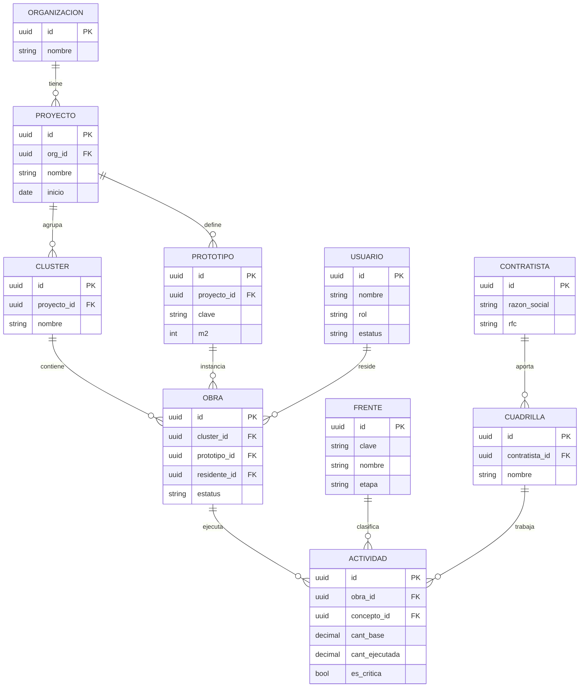
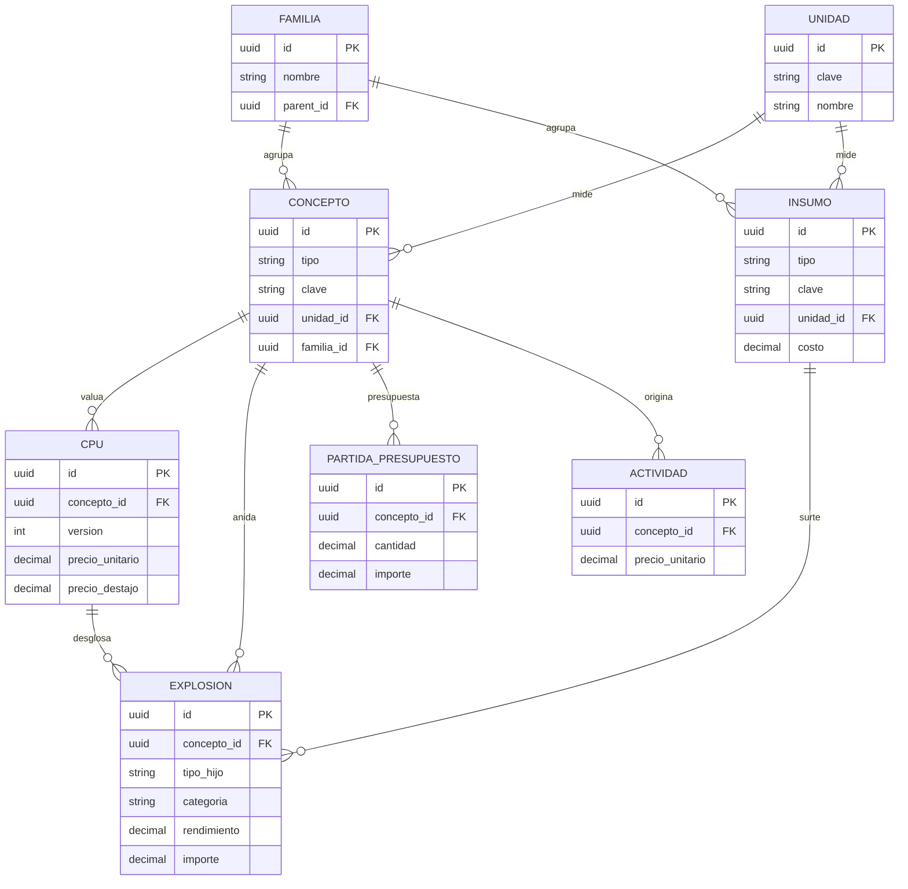
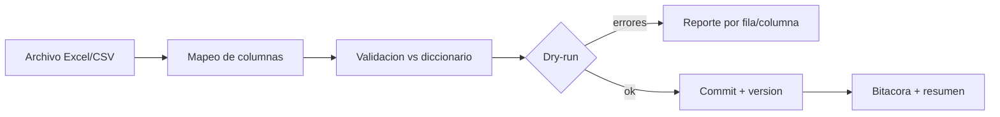
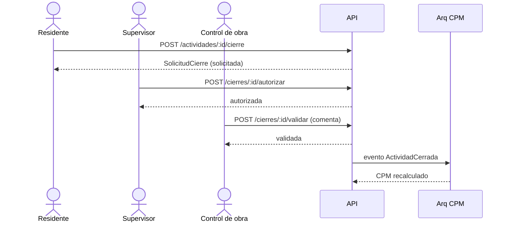
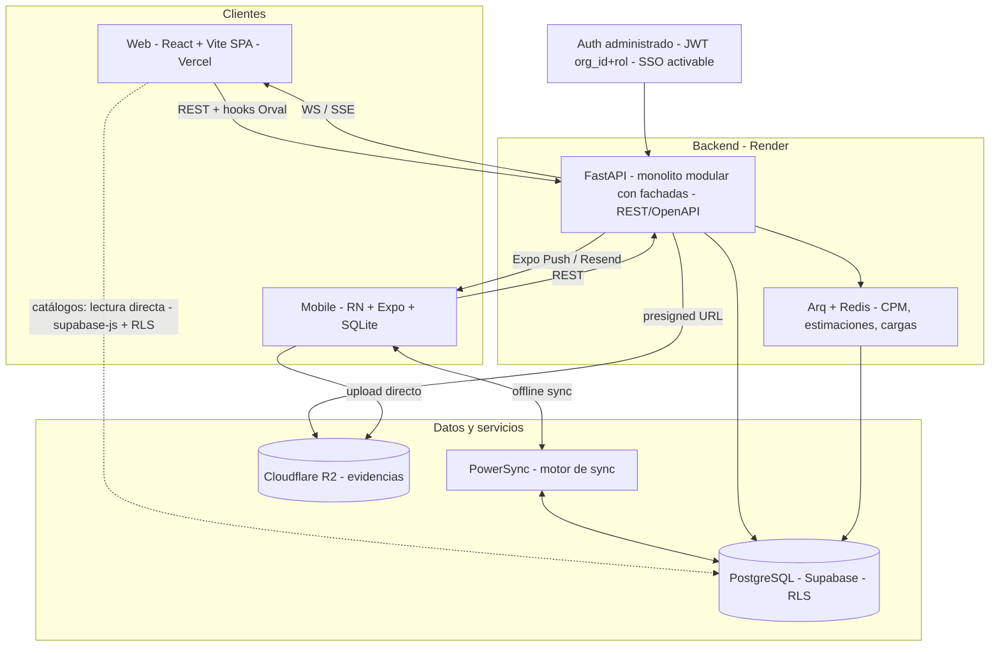

# ObraCtrl — Especificación técnica

> **Versión 0.2** — Especificación completa: dominio, datos, backend, stack y capa compartida.
> Documento base para el Proyecto de Claude.
> **Plataformas:** web (4 roles) · móvil (Residente, Supervisor, Control de obra). **Multi-tenant.**
> **Producto hermano:** *Sistema de Control y Auditoría de Obra* (back-office/offline); comparten la **capa de catálogos y cargadores** (§10).

## Índice
1. Visión general
2. Glosario canónico del dominio
3. Reglas transversales
4. Roles y permisos
5. Estructura de navegación
6. Reglas de negocio clave
7. Modelo de datos
8. Diccionario canónico
9. Cargadores de datos
10. Capa compartida: Catálogos y Cargadores
11. Backend — dominio y API
12. Stack tecnológico y arquitectura

> **Orden de lectura: conceptual → técnico.** Las secciones 2–3 fijan el vocabulario y las reglas que el resto del documento da por sentadas.

---

## 1. Visión general

ObraCtrl es una plataforma de **control de avance de obra** para construcción de vivienda en serie (contexto México, moneda MXN). Gestiona la jerarquía **Proyecto → Cluster → Obra** (cada lote/vivienda es una obra), la captura de avances en campo, la programación y **ruta crítica (CPM)**, incidencias, cierres, estimaciones semanales (destajo/concepto/subcontrato), control de materiales (consumo vs presupuesto), evaluaciones de desempeño y el expediente técnico por obra.

Es **multi-tenant**: cada constructora (organización) opera de forma aislada; todas las entidades llevan `org_id`.

---

## 2. Glosario canónico del dominio

> Definiciones únicas para todo el sistema. **✓ = término compartido** con el producto de Auditoría (vive en la capa común de catálogos, §10). Adaptado de la *Fuente de la Verdad* §2.

### 2.1 Estructura de proyecto
| Término | Definición | ✓ |
|---|---|---|
| **Proyecto / Desarrollo** | El desarrollo de vivienda que agrupa clusters (ej. `MAGNOLIA`). | ✓ |
| **Cluster / Manzana** | Agrupación de lotes (ej. `FRESNO`). | ✓ |
| **Obra / Lote** | Unidad mínima de control (ej. `FRESNO 01`); pertenece a un cluster y a un prototipo. | ✓ |
| **Prototipo** | Modelo de vivienda con ingeniería y presupuesto base repetible (clave `CAS-`). | ✓ |
| **URBA** | Obra única del desarrollo (calles, banquetas, áreas comunes); sin prototipo. | ✓ |
| **Frente de obra** | Etapa/gremio de ejecución (Cimentación, Estructura, Albañilería…). | |
| **Nivel** | Subcapítulo del presupuesto/obra (Cimentación, P. Baja, P. Alta…); clave `NIV-`. | ✓ |
| **Etapa de construcción** | Nivel 2 del presupuesto (ej. "ESTRUCTURA CIM"); con ponderación de avance; clave `ECO-`. | ✓ |

### 2.2 Costos y catálogos
| Término | Definición | ✓ |
|---|---|---|
| **CPU / APU** | Análisis de Precio Unitario: un concepto descompuesto en materiales, MO y/o subcontrato, con sus rendimientos. | ✓ |
| **Concepto** | Partida de obra (clave + descripción + unidad); clave `EST-`. | ✓ |
| **Insumo / Material** | Material consumible; vive en el catálogo de Materiales. | ✓ |
| **Rendimiento** | Cantidad de insumo (o MO) por unidad de concepto; base de la explosión. | ✓ |
| **Explosión de insumos** | Cantidad de concepto × rendimiento → insumos teóricos esperados. | ✓ |
| **Destajo** | Pago de MO por unidad de trabajo (lo que cobra la cuadrilla/contratista). | ✓ |
| **Subcontrato** | Trabajo subcontratado; clave `SUB-`. | ✓ |
| **Cuadrilla** | Equipo de trabajo; insumo del cálculo de avance. | ✓ |
| **Contratista** | Empresa/persona que ejecuta; se mapea desde catálogo. | ✓ |
| **Residente** | Responsable de obra que supervisa; se mapea desde catálogo. | ✓ |
| **Familia** | Agrupador de materiales o conceptos (en materiales define el IVA). | ✓ |
| **Variante / receta de CPU** | Composición alterna de un concepto (ej. "mortero" vs "cemento+arena"). | ✓ |
| **Grupo funcional** | Insumos intercambiables comparables en unidad común (ej. ligantes de repello). | ✓ |
| **Homologación** | Unificar varios registros en uno canónico, o agruparlos como equivalentes. | ✓ |
| **Mapeo** | Correspondencia entre un valor de archivo externo y el valor oficial del catálogo. | ✓ |

### 2.3 Operación y documentos
| Término | Definición | ✓ |
|---|---|---|
| **Estimación** | Documento de avance/pago; paga MO (destajo); los materiales los surte el almacén. Estados: previa/revisada/pagada. | ✓ |
| **Salida de almacén** | Material que egresó del almacén (consumo real). | ✓ |
| **Avance** | Ejecución de una actividad (cantidad ejecutada vs base). | |
| **Cierre de actividad** | Validación del avance de una actividad (solicita → autoriza → valida). | |
| **Cierre de obra** | Hito de entrega del lote completo; participan todos los roles. | |
| **Incidencia** | Problema/anomalía en obra (falta material, error, cambio…), con impacto en el programa. | |
| **Evaluación** | Valoración de desempeño (obra/residente/contratista) en niveles auto/control/final. | |
| **Expediente técnico** | Repositorio documental por obra (planos, contratos, actas, evidencias). | |
| **Revisión física** | Captura en campo de Control de obra (fotos, comentarios, calidad). | |
| **Lote de carga** (batch) | Conjunto de filas importadas en una carga; reversible como unidad. No confundir con "lote" = obra. | ✓ |
| **Bandeja de pendientes** | Excepciones que requieren confirmación humana antes de cerrar. | ✓ |

---

## 3. Reglas transversales

> Aplican a todo el sistema. Adaptadas de la *Fuente de la Verdad* §3; varias son **compartidas** con el producto de Auditoría.

### 3.1 Semana y año (base temporal)
- Todo se indexa por **semana + año**. Dos definiciones:
  - **Semana ordinaria:** lunes a domingo.
  - **Semana de obra:** jueves a miércoles (5 días laborales: jue, vie, lun, mar, mié; sáb/dom no laborales).
- **Calendario maestro:** mapea cada `(semana, año) → mes / trimestre / semestre` para **ambas** definiciones; un **selector** decide cuál usar por reporte.
- **Ancla en Configuración:** el admin fija la **semana actual** (ordinaria y de obra) + año; desde ese ancla el sistema numera todo y resuelve los **bordes de año** (semana 52/53 → 1).
- En ObraCtrl la captura de avance, las estimaciones y el programa/Gantt usan esta base; por defecto **semana de obra (jue–mié)**, conmutable.

### 3.2 Normalización de FOLIO (estimaciones)
- Folio único por fila: `FOLIO = [E-]WWYY-NNN` (`WW` = semana, `YY` = año, `NNN` = consecutivo; `E-` solo si el origen es ERP).
- El consecutivo **reinicia por (semana + año)** y es continuo (ERP y no-ERP comparten el contador de la semana).
- Un solo campo "semana" puede traer semana, código (`S-2126`) o folio completo; si ya viene con formato de folio, **se toma como folio** y se clasifican semana/año a partir de él. Sin año → año en curso.
- ERP es solo **metadato** (de qué sistema salió el dato); no hay integración en línea, los datos entran por Excel.

### 3.3 Prioridad de CLAVE (regla global)
- En **todos los catálogos** la **clave es única**; las descripciones varían.
- Todo análisis, mapeo, homologación y cruce **prioriza la comparación por CLAVE**; la descripción desempata, sugiere coincidencias o se usa cuando la clave falta.
- Por eso **mapear y homologar** es indispensable para unificar lo que apunta a la misma clave.

### 3.4 Jerarquía de fuentes (normalización)
Orden para resolver discrepancias de escritura/identidad:
```
1) CATÁLOGOS  = fuente de verdad (el valor oficial/canónico siempre manda)
2) ALMACÉN    > ESTIMACIÓN  (entre datos cargados, almacén tiene MAYOR jerarquía)
```
Aplica a contratista, obra, material y concepto; se combina con la prioridad de CLAVE (§3.3).

### 3.5 Moneda, IVA y unidades
- Moneda única: **MXN**.
- **IVA por material** (casilla en el catálogo de Materiales): valor inicial derivado de la **familia** (gravada → activada; Pétreos / Jardinería → desactivada); override por material. Tasa 16% y familias exentas son **configurables**.
- Unidades con **sinónimos / factor** (`pza→PZ`, `m2→M2`); factores de conversión (presentación o equivalencia) se definen al homologar (§10.3).

### 3.6 Umbral de desviación (configurable)
- Regla de desviación (real vs teórico/programado): **±5%** por defecto.
- Configurable a tres niveles: **global / por familia-concepto / por insumo**; se guarda el umbral usado en cada evaluación para trazabilidad.
- Es el **núcleo del producto de Auditoría** (cruce estimación ↔ almacén); en ObraCtrl aplica como umbral de alerta de **avance vs programa**.

---

## 4. Roles y permisos

Cuatro roles. **Un usuario = un rol.** Jerarquía de alcance creciente:

| Rol | Alcance | Plataforma | Resumen |
|---|---|---|---|
| **Residente de obra** | Sus obras | Web + móvil | Captura avances, incidencias y extra-catálogo; solicita cierres; autoevaluación |
| **Supervisor de obra** | Sus clusters | Web + móvil | Torre, incidencias, **autoriza cierres de actividad**, ruta crítica, asignaciones |
| **Control de obra** | Proyecto(s) asignados | Web + móvil (revisión) | Configuración (catálogos, presupuesto, programas, creador de obra); **valida + comenta** cierres; control de materiales; evaluaciones; revisión física en campo |
| **Super intendente de obra** | Global (todos los proyectos) | Solo web | Control general, presupuesto consolidado, rendimientos, bitácora, mejora de procesos, **cierre de obra final**, reportes totales |

**Distinción de permisos en el cierre de actividad:** `validar` ≠ `autorizar`.
El **Supervisor autoriza** (cierra la actividad), el **Control de obra valida y comenta** (no autoriza), y el **Super intendente** ejecuta el **cierre de obra final** (participan todos los roles).

---

## 5. Estructura de navegación

### 5.1 Web — sidebar por rol

**Residente de obra**
- *Mi trabajo:* Mis obras · Frentes de obra · Avances · Mis incidencias · Extra-catálogo · Mi ruta crítica · Control de materiales (lectura)
- *Reportes:* Autoevaluación · Guía de estimación · Expediente técnico

**Supervisor de obra**
- *Control supervisión:* Torre de control · Incidencias · Solicitudes de cierre · Ruta crítica
- *Equipo:* Asignaciones
- *Obras:* Obras supervisadas

**Control de obra**
- *Control de obra:* Torre de control · Incidencias · Cierres (validar + comentar) · Ruta crítica
- *Control de materiales:* Salidas de almacén · Consumo vs presupuesto
- *Reportes:* Evaluaciones · Guía estimado · Expediente técnico · Rendimientos
- *Configuración:* Programas base · Presupuesto · Creador de obra · Catálogos

**Super intendente de obra**
- *Control general:* Torre de control · Cierres de obra · Incidencias · Ruta crítica · Avance de proyecto
- *Presupuesto:* Presupuesto de obras · Rendimientos de obra · Bitácora de eventos · Mejora de procesos
- *Reportes:* Evaluaciones finales · Estimado total · Avance total · Programas de obra · Expediente técnico

### 5.2 Móvil

- **Residente** (campo, **captura offline**) — Tabs: *Obras · Avances · Incidencias · Ruta · Más*. Más → Frentes, Extra-catálogo, Control de materiales, Autoevaluación, Guía de estimación, Expediente.
- **Supervisor** (inspección) — Tabs: *Torre · Incidencias · Cierres · Ruta · Más*. Más → Obras supervisadas. (*Asignaciones es solo web.*)
- **Control de obra** (revisión física) — Tabs: *Obras · Revisión · Fotos · Calidad*. Solo revisión en campo (fotos, comentarios, calidad de los trabajos); toda la configuración es solo web.
- **Super intendente** — solo web.

### 5.3 Pantallas compartidas

Se implementan **una sola vez** y cambian comportamiento por **rol** y **alcance** (no se duplican): Torre de control, Incidencias, Ruta crítica, Cierres, Estimación, Evaluación, Expediente técnico, Presupuesto, Rendimientos, Avance/Obras.

---

## 6. Reglas de negocio clave

**Captura de avance**
- `cant_programada ≤ cant_base × 1.2`
- `cant_ejecutada ≤ cant_programada`
- `avance_pct = cant_ejecutada / cant_base × 100`
- Auto-estatus: `≥ 90% → casi` · `> 0 → en_proceso`

**Cierre de actividad**
- Residente **solicita** → Supervisor **autoriza** → Control de obra **valida y comenta** (no autoriza).
- Genera `monto = cantidad × precio_unitario`; requiere checklist + evidencias.

**Cierre de obra (final)**
- Hito de entrega del lote completo. **Participan todos los roles.** Acta + evidencias.

**Estimación**
- Corte **semanal**. `modo ∈ {destajo, concepto, subcontrato}`.
- Importe = `cantidad_validada × precio` (destajo = MO; concepto = CPU completo; subcontrato = monto subcontratado).
- Estatus: borrador → enviada → validada. Exporta **Excel**.

**Ruta crítica (CPM)**
- Se calcula sobre el cronograma (`ProgramaObra` + actividades con inicio/duración/dependencias). Determina holgura, desfase y ruta crítica. **Recálculo programado + on-demand.** Alerta si una actividad crítica se atrasa más del umbral.

**Incidencias**
- Ciclo: abierta → programada → en_atención → cierre_solicitado → cerrada / rechazada.
- Impacto: *detalle* (no afecta programa) · *retraso* (suma días) · *detiene* (frena la obra). Puede bloquear actividades.

**Control de materiales**
- Control de obra carga `SalidaAlmacen` (salida de almacén por obra). El consumo real se compara contra el presupuesto (por material/concepto). El Residente lo ve en lectura.

**Evaluaciones**
- 3 niveles: *auto* (Residente: a sí mismo + su obra) → *control* (Control de obra: obra + residente + contratista) → *final* (Super intendente).
- Sujetos: obra, residente, contratista. Criterios configurables por sujeto.

---

## 7. Modelo de datos

Multi-tenant: toda tabla incluye `org_id` (salvo `Organizacion`). Campos estándar `id` (uuid), `created_at`, `updated_at` implícitos. Importes en `DECIMAL`.

### 7.1 Identidad y organización
- **Organizacion** — tenant. `nombre`, `slug`, `plan`, `estatus`.
- **Usuario** — `nombre`, `email`, `rol` (residente | supervisor | control_obra | super_intendente), `cedula`, `telefono`, `estatus`.

### 7.2 Estructura de proyecto
- **Proyecto** — `nombre`, `ubicacion`, `inicio`, `fin_estimado`.
- **Cluster** — `proyecto_id`, `nombre` (manzana).
- **Prototipo** — `proyecto_id`, `clave`, `nombre`, `m2`, `niveles`, `recamaras`.
- **Obra** — `cluster_id`, `prototipo_id`, `clave` (lote), `residente_id`, `estatus` (pendiente | iniciada | en_proceso | por_entregar | entregada), `fecha_inicio`, `avance_pct`.
- **Frente** — `clave`, `nombre`, `etapa`, `orden`, `color` (catálogo de frentes/etapas).

### 7.3 Catálogos maestros y APU (análisis de precios unitarios)
Recursos base + conceptos anidables (auxiliares y matrices).
- **Unidad** — `clave`, `nombre` (m², ml, pza…).
- **Familia** — `nombre`, `parent_id` (árbol de familias).
- **Insumo** (recurso base) — `tipo` (material | mano_obra | equipo | herramienta), `clave`, `descripcion`, `unidad_id`, `familia_id`, `costo`.
- **Concepto** — `tipo` (concepto | auxiliar | matriz | basico), `clave`, `descripcion`, `unidad_id`, `familia_id`. *(El `tipo` permite anidar auxiliares y matrices.)*
- **Explosion** (composición recursiva / APU) — `concepto_id` (padre), `tipo_hijo` (insumo | concepto), `insumo_id?`, `concepto_hijo_id?`, `categoria` (material | mano_obra | equipo | destajo | subcontrato | auxiliar | matriz), `cantidad` / `rendimiento`, `costo_unitario`, `importe`.
- **CPU** (precio unitario por versión) — `concepto_id`, `version`, `precio_unitario` (total), `precio_destajo` (porción MO/destajo/subcontrato), `vigente`.
- **Material** = `Insumo` con `tipo = material`.
- **Contratista** — `razon_social`, `rfc`, `contacto`, `telefono`, `email`, `calificacion`, `estatus`.
- **ContratistaFrente** (puente) — `contratista_id`, `frente_id`.

> **Costeo:** el **destajo** = mano de obra o subcontrato (lo que cobra la cuadrilla); el **CPU** = costo total (materiales + auxiliares + matrices + MO + equipo). Se estima por **destajo**, **concepto** completo o **subcontrato**.

### 7.4 Plantilla de prototipo (árbol WBS) y presupuesto
- **PrototipoNodo** (árbol) — `prototipo_id`, `parent_id`, `tipo` (etapa | nivel | concepto), `nombre`, `concepto_id?`, `orden`, `cantidad`. Organiza los conceptos del prototipo por **etapas de construcción** y **niveles**.
- **Presupuesto** — `prototipo_id`, `version`, `vigente`, `origen` (Excel). Cargado por Control de obra.
- **PartidaPresupuesto** — `presupuesto_id`, `concepto_id` / `prototipo_nodo_id`, `cantidad`, `precio_unitario`, `importe`.

### 7.5 Programación
- **ProgramaBase** — `prototipo_id`, `version`, `vigente` (plantilla de duraciones).
- **ProgramaBaseItem** — `programa_base_id`, `frente_id` / etapa, `prototipo_nodo_id?`, `duracion_dias`, `dependencias` (jsonb), `orden`.
- **ProgramaObra** — `obra_id`, `version`, `fecha_corte` (cronograma instanciado).
- *Ruta crítica:* campos calculados en `Actividad` (ver §7.6) + motor CPM.

### 7.6 Ejecución y avance
- **Actividad** (avance) — `obra_id`, `concepto_id`, `frente_id`, `nivel`, `cuadrilla_id`, `contratista_id`, `cant_base`, `cant_programada`, `cant_ejecutada`, `avance_pct`, `precio_unitario`, `precio_destajo`, `modo_pago` (destajo | concepto | subcontrato), `fecha_inicio`, `fecha_termino`, `estatus`, `inicio_semana`, `duracion_dias`, `dependencias` (jsonb), `es_critica`, `holgura`, `desfase`, `extra` (bool), `notas`.
- **Cuadrilla** — `contratista_id`, `nombre`, `lider`, `integrantes`, `frente_id`.
- **RegistroAvance** — `actividad_id`, `fecha`, `delta_ejecutado`, `usuario_id`, `evidencias`, `sync_status`. Bitácora de captura diaria; soporta **sincronización offline** del Residente.
- **Estimacion** — `obra_id`, `semana`, `modo` (destajo | concepto | subcontrato), `estatus` (borrador | enviada | validada), `monto_total`.
- **EstimacionConcepto** — `estimacion_id`, `actividad_id`, `cantidad_validada`, `precio_unitario`, `importe`.

### 7.7 Materiales
- **SalidaAlmacen** — `obra_id`, `fecha`, `usuario_id` (control de obra), `insumo_id` (material), `cantidad`, `costo`, `referencia`. *Consumo real vs presupuesto = vista derivada.*

### 7.8 Control y flujos
- **Incidencia** — `obra_id`, `frente_id`, `tipo`, `impacto` (detalle | retraso | detiene), `titulo`, `descripcion`, `creada_por`, `asignada_a`, `estatus`, `fecha_creada`, `fecha_limite`, `dias_retraso`, `bloquea_actividades` (jsonb).
- **IncidenciaEvento** — `incidencia_id`, `fecha`, `usuario_id`, `accion`, `comentario` (historial).
- **SolicitudCierre** (cierre de actividad) — `actividad_id`, `solicitada_por` (residente), `cantidad`, `monto`, `checklist` (jsonb), `adjuntos`, `estatus`, `autorizada_por` (supervisor), `validada_por` (control de obra), `comentarios`.
- **CierreObra** (cierre final) — `obra_id`, `estatus`, `fecha`, `acta`, `evidencias`, `participantes` (jsonb).
- **Evaluacion** — `sujeto_tipo` (obra | residente | contratista), `sujeto_id`, `evaluador_id`, `nivel` (auto | control | final), `periodo`, `puntaje`, `comentarios`.
- **CriterioEvaluacion** (catálogo) — `aplica_a` (obra | residente | contratista), `nombre`, `peso`.
- **EvaluacionRespuesta** — `evaluacion_id`, `criterio_id`, `valor`.
- **RevisionFisica** — `obra_id`, `actividad_id?`, `incidencia_id?`, `usuario_id` (control de obra), `fecha`, `fotos`, `comentario`, `calidad`. *Entidad propia que además puede vincularse a un avance o a una incidencia.*

### 7.9 Soporte
- **ExpedienteDoc** — `obra_id`, `tipo` (plano | contrato | acta | evidencia | bitacora | otro), `nombre`, `url`, `subido_por`, `fecha`.
- **Proceso** — `nombre`, `descripcion`, `definido_por` (super intendente), `estatus` (mejora de procesos).
- **Bitacora** — `entidad`, `entidad_id`, `usuario_id`, `accion`, `datos` (jsonb), `fecha` (auditoría global).
- **Evidencia** — `tipo`, `url`, `entidad`, `entidad_id` (adjunto genérico en object storage).
- **SupervisorCluster** (puente) — `supervisor_id`, `cluster_id`.
- **Notificacion** (opcional) — `usuario_id`, `tipo`, `payload`, `leida`.

### 7.10 Diagramas ER (referencia)

**Núcleo — estructura de proyecto y ejecución**


**Catálogos maestros y APU**


---

## 8. Diccionario canónico

Fuente única de verdad para nomenclatura, tipos, enumeraciones, unidades y términos del dominio. Lo consumen el esquema de BD, los contratos de API, los tipos del paquete `shared` (web + móvil) y, sobre todo, los **cargadores de datos** (§9), que mapean encabezados externos a estos nombres canónicos.

### 8.1 Convenciones de nomenclatura
- Entidades (modelo) en `PascalCase`; tablas en `snake_case` plural; campos en `snake_case`.
- `id` uuid (PK); llaves foráneas `<entidad>_id`; timestamps `created_at` / `updated_at`.
- Booleanos `es_*` / `tiene_*`; fechas `fecha_*`; cantidades `cant_*`; importes en `DECIMAL`.
- Valores de enum en `snake_case` minúscula.

### 8.2 Enumeraciones canónicas

| Campo | Valores |
|---|---|
| `usuario.rol` | residente · supervisor · control_obra · super_intendente |
| `obra.estatus` | pendiente · iniciada · en_proceso · por_entregar · entregada |
| `actividad.estatus` | programada · en_proceso · casi · pendiente_cierre · concluida · retrasada · extra_catalogo |
| `actividad.modo_pago` · `estimacion.modo` | destajo · concepto · subcontrato |
| `insumo.tipo` | material · mano_obra · equipo · herramienta |
| `concepto.tipo` | concepto · auxiliar · matriz · basico |
| `explosion.categoria` | material · mano_obra · equipo · destajo · subcontrato · auxiliar · matriz |
| `explosion.tipo_hijo` | insumo · concepto |
| `incidencia.tipo` | falta_material · error_ejecucion · cambio_cliente · proyecto_indef · retrabajo · detalle |
| `incidencia.impacto` | detalle · retraso · detiene |
| `incidencia.estatus` | abierta · programada · en_atencion · cierre_solicitado · cerrada · rechazada |
| `solicitud_cierre.estatus` | solicitada · autorizada · validada · rechazada |
| `cierre_obra.estatus` | en_proceso · cerrada |
| `estimacion.estatus` | borrador · enviada · validada |
| `evaluacion.sujeto_tipo` | obra · residente · contratista |
| `evaluacion.nivel` | auto · control · final |
| `prototipo_nodo.tipo` | etapa · nivel · concepto |
| `expediente_doc.tipo` | plano · contrato · acta · evidencia · bitacora · otro |
| `carga_datos.tipo` | catalogo_conceptos · materiales · contratistas · unidades · familias · presupuesto · programa_base · obras |
| `carga_datos.estatus` | pendiente · validando · previsualizado · aplicado · error |

### 8.3 Frentes canónicos (catálogo base)
`PRE` Preliminares · `CIM` Cimentación · `EST` Estructura · `ALB` Albañilería · `HID` Hidrosanitaria · `ELE` Eléctrica · `ACA` Acabados · `HER` Herrería / carpintería.

### 8.4 Unidades canónicas (semilla)
`m2` · `m3` · `ml` · `pza` · `kg` · `ton` · `lote` · `jornal` · `global` · `viaje` · `%`.

### 8.5 Glosario del dominio
Obra (= lote / vivienda) · Cluster (= manzana) · Prototipo (modelo de casa) · Frente (etapa / gremio) · Concepto (partida ejecutable) · Insumo (recurso base) · CPU / APU (análisis de precio unitario) · Auxiliar / Matriz (análisis anidados) · Destajo (MO o subcontrato que cobra la cuadrilla) · Estimación (corte de cobro) · Avance (ejecución de una actividad) · Cierre de actividad (≠ cierre de obra).

### 8.6 Mapa de sinónimos (alias → canónico)
Clave para los cargadores, dado que los Excel externos usan encabezados variados:

| Alias frecuentes | Canónico |
|---|---|
| Código · Code · Clave · No. | `clave` |
| Descripción · Concepto · Partida | `descripcion` |
| U · UM · Unidad de medida | `unidad` |
| P.U. · PU · Precio unitario | `precio_unitario` |
| Cant · Cantidad · Volumen · Vol. | `cantidad` |
| Importe · Total · Subtotal | `importe` |
| Rend. · Rendimiento | `rendimiento` |

### 8.7 Dos niveles: invariantes vs semilla editable
El diccionario se divide en dos niveles, para que el negocio crezca **sin programador** salvo cuando cambia la lógica (*Fuente de la Verdad* §4.5):

- **Invariantes (solo código):** valores que **no cambian sin un cambio real de lógica**. Aquí entran estados y tipos: `usuario.rol`, `*.estatus` (obra, actividad, estimación, incidencia, cierre), `evaluacion.nivel`, `modo_pago` / `estimacion.modo`, `concepto.tipo`, `prototipo_nodo.tipo` (`ClaseNodo`), `explosion.categoria` / `tipo_hijo`, `ModoCarga` (§10.2), `TipoSemana` (§3.1) y —en la capa compartida— `TipoComponente`, `EstadoEstimacion` (previa/revisada/pagada) y `HojaEstimacion` (OBRA/INSTALACIONES/URBA/EXT). Un valor fuera de estos → **bandeja de pendientes**; agregar uno nuevo **sí** es trabajo de programador (ocurre casi nunca).
- **Semilla editable (código siembra → BD/Configuración manda → usuario edita):** `Unidad` (+ sinónimos/factor), **familias → IVA**, `PREFIJOS` de clave, `Frente` (catálogo), `MotivoAlmacen` (+ signo/bucket, del producto de Auditoría) y los `DEFAULTS` configurables. El código solo trae el **valor por defecto** (semilla + validación); la **lista viva** vive en tablas de Configuración (PostgreSQL). El usuario agrega/edita desde **Configuración + bandeja de pendientes** (§10.3), **sin tocar código**.

**Caveat de configurables:** los valores configurables (IVA 16%, umbral ±5%, similitud 90%, familias exentas) viven en código **solo como `default` / fallback**. En runtime el sistema **lee primero de Configuración/BD**; si no encuentra el parámetro, usa el default canónico. Nunca se "clava" un configurable como constante de cálculo.

**Materialización:** los **invariantes** son `enum.Enum` + `dataclass` en el paquete `shared` (núcleo determinista, sin dependencias). La **semilla editable** se siembra en código pero la lista viva se carga de BD al arrancar y el dominio valida contra ella. Resultado: lo **estructural** queda blindado en código; lo que el negocio **extiende con el tiempo** lo administra el usuario.

---

## 9. Cargadores de datos

Importadores que toman archivos externos (Excel / CSV), los validan contra el **diccionario canónico** (§8), mapean columnas → campos canónicos y cargan a la BD de forma **idempotente** y **versionada**.

### 9.1 Inventario de cargadores
- **Catálogo de conceptos / APU (CPU)** — conceptos + insumos + explosión (auxiliares y matrices). Origen típico: Excel exportado de Opus / Neodata u hoja propia.
- **Catálogo de materiales** — material, unidad, familia, costo.
- **Catálogo de contratistas** — razón social, RFC, frentes.
- **Unidades / Familias** — listas maestras.
- **Presupuesto por prototipo** — partidas (concepto × cantidad × PU) + árbol WBS (`PrototipoNodo`: etapas / niveles).
- **Programa base** — duraciones por etapa × prototipo + dependencias.
- **Obras (lotes)** — alta masiva de obras de un cluster (cluster, prototipo, clave, residente).

### 9.2 Pipeline de carga
`Archivo (Excel/CSV)` → `Mapeo de columnas (sinónimos → canónico)` → `Validación (tipos, enums, unidades, FKs, reglas)` → `Previsualización / dry-run` → `Commit transaccional + versión` → `Reporte de resultados`.



### 9.3 Características transversales
- **Idempotencia / upsert por `clave`** — recargar no duplica.
- **Versionado** — presupuesto, programa base y CPU crean versión nueva; la anterior queda histórica.
- **Dry-run obligatorio** — previsualización con conteo de insertados / actualizados / omitidos / errores antes de aplicar.
- **Validación contra §8** — enums, unidades y sinónimos.
- **Reporte de errores por fila / columna** descargable.
- **Multi-tenant** — toda carga scoped a `org_id`.
- **Plantillas descargables** — un Excel template por cargador, alineado al diccionario.
- **Trazabilidad** — cada carga se registra en `Bitacora` y en la entidad `CargaDatos`.

### 9.4 Entidad
- **CargaDatos** (ImportJob) — `tipo` (ver §8.2), `archivo_url`, `estatus` (pendiente | validando | previsualizado | aplicado | error), `usuario_id`, `resumen` (jsonb: filas, insertados, actualizados, omitidos, errores), `version_generada`, `fecha`.

---

## 10. Capa compartida: Catálogos y Cargadores (puente con el producto de Auditoría)

> **Dos productos, una base común.** ObraCtrl (operación/campo, nube/móvil) y el **Sistema de Control y Auditoría de Obra** (back-office/offline, *Fuente de la Verdad*) son productos distintos, pero **comparten los catálogos maestros y sus cargadores**. Esta sección es la **superficie de compatibilidad**: ambos consumen las mismas claves canónicas, prefijos y cabeceras de carga, para que en el futuro puedan **intercambiar datos** sin reconciliación.
> Referencia de detalle: *Fuente de la Verdad* — §2 (glosario), §4 (catálogos) y §10 Apéndice A (cabeceras por archivo).

### 10.1 Catálogos canónicos (set compartido)
Clave única por registro; la descripción es secundaria. Prefijos de clave: `EST` concepto · `SUB` subcontrato · `SER` servicio · `MOA/MOS` mano de obra · `NIV` nivel · `ECO` etapa · `CAS` prototipo.

| Catálogo | Campos clave |
|---|---|
| **Conceptos (CPU/APU)** | clave, descripción, unidad, familia_concepto, precio_unitario, **versión/variante**, composición (insumos/MO/subcontrato + **rendimiento**) |
| **Materiales (Insumos)** | clave, descripción, unidad, familia, **costo_base**, **costo_base_actualizado** (vigente), **costo_promedio_almacen**, **origen** (base/almacén), **iva_aplica** (casilla), factor_conversión |
| **Mano de obra (Destajos)** | clave, clave_usuario, descripción, unidad, cuadrilla, rendimiento_teórico/real, costo_unitario, familia |
| **Subcontratos** | clave (`SUB-`), descripción, unidad, cuadrilla, rendimiento, costo_unitario, familia |
| **Cuadrillas** | clave, descripción, integrantes, rendimiento/capacidad |
| **Contratistas / Residentes** | clave, nombre/razón social, alias (mapeo), activo |
| **Obras (Lotes)** | clave = `CLUSTER + LOTE` (`FRESNO 12`); proyecto, cluster, prototipo, m2, fechas, estatus |
| **Familias** (materiales / conceptos) | clave, descripción, **iva_aplica** (materiales) |
| **Niveles** (`NIV-`) | clave, orden, descripción (Cimentación, P. Baja…), importe |
| **Etapas de construcción** (`ECO-`) | clave, orden, descripción por nivel, **ponderación** (peso % avance), importe |
| **Catálogo de Obra (presupuesto jerárquico)** | árbol `Prototipo(CAS) → Nivel(NIV) → Etapa(ECO) → Concepto(EST)`; col `CLASE` = rol del nodo |
| **Variantes/recetas de CPU** | concepto, código_variante, composición, asignación por concepto + lote |
| **Grupos funcionales de insumos** | código_grupo, insumos miembros, unidad común + factor (insumos intercambiables) |
| **Mapeos / Homologaciones** | alias → valor oficial · claves_origen[] → clave canónica (+ factor de conversión) |

> Expande nuestro §7.3–§7.4: incorpora Mano de obra, Subcontratos, Cuadrillas, Niveles, Etapas, Variantes, Grupos funcionales, Mapeos/Homologaciones y el árbol de presupuesto con `CLASE`.

### 10.2 Cargadores — modos y pipeline
Toda carga es **multi-archivo**, muestra **vista previa** antes de aplicar, y corre en uno de tres **modos**:
- **Actualizar** (default) — deduplica por clave, actualiza existentes, agrega nuevos.
- **Acumular** — solo agrega nuevos, sin tocar lo actual.
- **Reemplazar** — sustituye todo el conjunto (con confirmación).

Cada carga genera un **lote de carga** (id, archivo, hash, conteo, duplicados) **reversible como unidad**, idempotente por **clave**. Las **cabeceras canónicas** por archivo son el contrato compartido (*Fuente* Apéndice A): almacén, CPU/conceptos, materiales, mano de obra, subcontratos, obras, niveles, etapas y presupuesto jerárquico.

### 10.3 Mapeos, homologaciones y bandeja de pendientes
- **Mapeo:** alias de archivo externo → valor oficial del catálogo (contratista, residente, obra, concepto).
- **Homologación:** unificar varias claves en una canónica, o agrupar intercambiables (grupo funcional) con unidad común + factor.
- **Prioridad de CLAVE:** todo cruce/mapeo prioriza la clave; la descripción desempata.
- **Bandeja de pendientes:** las excepciones (mapeo no reconocido, CPU nuevo, variante/unidad/IVA por confirmar, fila no parseada) caen en una bandeja única con liga al origen; el sistema **propone, el humano confirma**, y lo resuelto re-alimenta la carga. Puede **bloquear el cierre** si hay pendientes críticos.

### 10.4 Compatibilidad futura
Como ambos productos parten de las mismas claves, prefijos y cabeceras, la integración futura es **intercambio de catálogos y datos** (export/import o API), no una reconciliación. ObraCtrl aporta la **operación de campo** (avance, incidencias, cierres) y el producto de Auditoría aporta el **cruce de costos** (estimación pagada ↔ consumo de almacén); el puente natural son los **conceptos (CPU)**, las **obras/lotes** y las **estimaciones**.

### 10.5 Almacén y valuación de materiales (compartido)
> Modelo de movimientos y valuación de materiales, común a ambos productos. En ObraCtrl alimenta "Control de materiales" (consumo vs presupuesto); el dashboard completo de KPIs de almacén es del producto de Auditoría. (*Fuente* §3.4, §3.9, §5.2.)

**Movimientos de almacén** — cada movimiento trae **motivo + signo + importe**. Motivos canónicos con su signo y bucket de KPI:

| Motivo | Signo | Bucket KPI |
|---|---|---|
| Recepción de material | + | INGRESOS |
| Inventario inicial | + | base de importe total |
| Sobrantes | + | AJUSTES (+) |
| Salida para producción · Implosión de materiales | − | SALIDAS |
| Consumos internos · Devolución cliente | − | importe total (fuera de SALIDAS) |
| Faltantes · Ajuste de inventario | − | AJUSTES (−) |

El signo viene en el archivo (`Efecto Qty` / `Efecto Costo`); el motivo solo clasifica el bucket. Motivo no catalogado → **bandeja de pendientes** (§10.3). Es **semilla editable** (el usuario agrega motivos con su signo/bucket, §8.7).

**KPIs de almacén** — `SALIDAS` e `INGRESOS` con definición **fija**; `BALANCE = SALIDAS + INGRESOS`; `AJUSTES` (±).

**Valuación de materiales** — dos precios por insumo: **precio base** (catálogo) y **precio de almacén** = **costo último** (`C/Último`). El sistema calcula `costo_promedio_almacen` desde el costo último; `costo_base_actualizado` = el costo último más reciente (**costo vigente**). Si el promedio calculado discrepa del `C/Promedio` del archivo → alerta de **variación de precio**.

**Regla de valuación para comparar consumo vs presupuesto/teórico:**
1. **Insumo con cruce** (en la explosión del CPU **y** en las salidas) → **costo último** (mismo precio a ambos lados: la diferencia en dinero refleja solo cantidad/rendimiento).
2. **Insumo solo en la explosión** (esperado, sin salida) → **precio base** del catálogo.
3. **Insumo solo en almacén** (consumido, no esperado) → **costo último**.

La desviación se reporta primero en **cantidad** (independiente de IVA y precio) y luego en **importe**, con el mismo tratamiento de IVA en ambos lados.

### 10.6 Cabeceras canónicas de carga (contrato de cargadores)
> El contrato exacto de columnas por archivo — la parte más concreta de la capa compartida. Resumen de las columnas **clave** (la *Fuente* §10 Apéndice A las mapea completas). Los catálogos internos/derivados no llevan archivo.

**Movimientos de almacén** (`IMPORTAADOR_ALMACEN.xlsx`, hoja `Consulta`, 46 col): clave del material = **# Parte**; descripción = **Parte**; familia/IVA = **Clase** (PET exento…); obra = **Ubicacion + Lote**; contratista = **Contratista**; fecha → semana de obra = **Fecha**; motivo (bucket KPI) = **Motivo**; cantidad con signo = **Efecto Qty**; importe con signo = **Efecto Costo**; **costo del cruce = C/Último** (C/Promedio solo valida); liga al concepto = **Referencia** (`No.Parte:EST-…` + OP); almacén = **# Almacen / Almacen**; usuario (bitácora) = **Usuario**. *El signo ya viene en el archivo; los costos vienen sin IVA y se agrega 16% según `Clase`.*

**CPU / Conceptos** (`CABECERAS_CPU.xlsx`, hoja `EXPORTADOR`, formato plano): por cada concepto, una fila **encabezado** (`TIPO=Concepto`, A=B) + sus filas **componente** (`TIPO=Material/Mano de obra/Subcontrato`). Columnas: **CLAVE concepto** (A), **clave insumo** (B en componente), descripción (C), unidad (D), **rendimiento = CANTIDAD** (E, en componente), PU (F), **FAMILIA** (H), **TIPO** (I). Materiales se matchean por **clave** (B) con catálogo y almacén. El árbol de **presupuesto** (`CATALOGO_DE_OBRA.xlsx`) usa el mismo cargador + columna **CLASE** (`PROTOTIPO / NIVEL / ETAPA / CONCEPTO AUXILIAR / CONCEPTO`).

**Materiales** (`CABECERAS_MATERIALES.xlsx`): clave, descripción, unidad, familia, costos (base / último / promedio), IVA. **Mano de obra** (`CABECERAS_MANO_DE_OBRA.xlsx`, `DESTAJOS`) y **Subcontratos** (`catalogo_de_SUBCONTRATOS.xlsx`): TIPO, **clave usuario** (mapeo), **clave oficial** (`MOA-` / `SUB-`), descripción, unidad, cuadrilla, rendimiento teórico/real, **costo unitario**, familia.

**Obras / Lotes** (`CABECERAS_LOTES.xlsx`, 16 col): clave = **CLUSTER + OBRA/LOTE**; proyecto, cliente, **prototipo**, m² (base/adicionales/total *calc*), fechas/duración (varias **calculadas** por el programa/avance), estatus. **Contratistas / Residentes** (`DATOS_OFICIALES.xlsx`): listas oficiales para normalizar (con variantes a **homologar**). **Niveles** (`CATALOGO_DE_NIVELES.xlsx`): índice, **CLAVE `NIV-`**, descripción. **Etapas** (`CATALOGO_DE_ETAPAS…xlsx`): índice, **CLAVE `ECO-`**, descripción (+ nivel), **ponderación** (peso % avance).

**Estimaciones** (`CABECERAS_ESTIMACIONES.xlsx`, hojas OBRA / INSTALACIONES / EXT / URBA): obra = `LOTE/CLUSTER` | `MZ-LOTE` | `CLOUSTER`; cantidad = `CANTIDAD` | `CANT.`; precio = `P.U.` (= **mano de obra**); `CLAVE` = concepto | MO | `FUERA DE CATALOGO`. EXT = subcontratos (Control de OT: `TOTAL` vs `TOTAL PTTO`); URBA trae **columnas geométricas** que calculan la cantidad.

### 10.7 Acceso directo a catálogos (Supabase + RLS)
> Los **catálogos** se sirven **directo de la base (Supabase) al frontend**, sin pasar por el backend, con el cliente **supabase-js** y **RLS** como frontera de seguridad. Da catálogos rápidos y en **tiempo real** para selects, tablas y filtros. El **backend (FastAPI) se reserva para la lógica**: cargas/ETL, validación canónica, CPM, estimaciones, auditoría y cierres.

- **Lectura:** el front consulta catálogos vía supabase-js; **RLS** filtra por `org_id` (§12.4). Realtime opcional para reflejar cambios al instante.
- **Ediciones simples** (semilla editable §8.7: unidad, familia/IVA, activar/desactivar): pueden ir **directo a Supabase** con **RLS + restricciones de BD** (checks, llaves foráneas, unicidad de clave) que preservan los invariantes; las que requieren validación compleja pasan por el backend.
- **Cargas y operaciones validadas:** **siempre** por el backend (Pandas, diccionario canónico, versionado §10.8, bandeja §10.3).
- **Seguridad (crítico):** como el front toca la BD directo, **RLS es obligatorio y es la única frontera** de esa ruta. Se usa la **anon key** + políticas por rol/org; **la *service key* nunca** llega al cliente.

### 10.8 Versionado y reversa de cargas
> Cada carga es **versionada y reversible**: permite corregir errores y auditar cómo cambió un dato en el tiempo.

- **Cada carga = una versión** (snapshot) del conjunto afectado: id de lote, archivo, hash, fecha, usuario y conteos (altas/bajas/cambios).
- **Detección de cambios (diff):** al cargar un archivo del **mismo tipo/entidad**, el sistema compara contra la **versión vigente**; si hay diferencias genera **una nueva versión** y guarda el **diff** (qué cambió). Si es idéntico, **no crea versión** (idempotente por clave, §12.3).
  - *Ejemplo:* se carga `materiales.xlsx` → **v1**. Luego se sube otro `materiales.xlsx`; el sistema detecta que **3 precios cambiaron y 2 claves son nuevas** → **v2** con ese diff; **v1** queda en el historial.
- **Eliminar cargas erróneas:** una carga se **revierte/elimina como unidad** (el lote completo), dejando los datos como estaban **antes** de esa carga (regresa a la versión previa). No se borra registro por registro: se revierte el lote.
- **Comparar y restaurar:** se ve el **historial de versiones**, se comparan dos y se puede **restaurar** una anterior.
- Aplica a catálogos y datos cargados (materiales, CPU, obras, presupuesto, estimaciones…). El acceso directo (§10.7) lee **siempre la versión vigente**.

---

## 11. Backend — dominio y API

### 11.1 Capa de dominio (DDD pragmático)
El backend es un **monolito modular**: cada módulo es un **bounded context** con su propio lenguaje (el diccionario canónico §8 es el lenguaje ubicuo). Contextos: Identidad/Org · Catálogos/APU · Proyecto-Obra · Programación/CPM · Ejecución/Avance · Estimación · Materiales · Incidencias · Cierres · Evaluación · Cargas · Expediente.

**Anatomía de un módulo** (capas internas):
- **Router** — endpoints FastAPI (REST/OpenAPI).
- **Fachada** — interfaz pública del módulo; **toda llamada entre módulos pasa por aquí**, nunca a los internos de otro.
- **Servicio de dominio** — casos de uso; aplica invariantes y reglas de negocio (§6).
- **Modelo de dominio** — entidades + **value objects** con comportamiento.
- **Repositorio** — acceso a datos (SQLModel), siempre scoped por RLS (`org_id`).
- **Schemas/DTOs** — Pydantic de request/response; separados del modelo, alimentan OpenAPI.

**Modelo de dominio vs persistencia:** enfoque **pragmático** — los modelos **SQLModel** sirven como entidad de persistencia y de dominio; la lógica vive en los **servicios de dominio** y en métodos de las entidades. Para los contextos con lógica pesada (**APU/CPU** y **CPM**) se extraen entidades de dominio puras cuando convenga.

**Reglas e invariantes (única fuente de verdad):** las reglas de §6 se definen una vez. Las que el frontend necesita para UX (p. ej. `cant_programada ≤ cant_base × 1.2`, `avance% = ejecutada/base`) viven en `packages/shared` y el front las **refleja**; el backend las **aplica de forma autoritativa** en los servicios de dominio.

**Value objects:** `Dinero` (DECIMAL + MXN) · `Cantidad` (valor + unidad) · `Avance` (0–100) · `Periodo/Semana` · `PrecioUnitario` (CPU con desglose de destajo). Encapsulan sus invariantes.

**Eventos de dominio** (desacoplan los contextos; in-process o vía Arq):
- `ActividadCerrada` → recalcular **CPM** + impactar **estimación**.
- `IncidenciaCreada(impacto=detiene)` → marcar **actividades bloqueadas** + recalcular ruta.
- `EstimacionValidada` → notificar (Resend) + bloquear el periodo.
- `CierreObra` → cerrar pendientes + congelar la obra.

**Comunicación entre contextos:** solo por **fachadas** + **eventos de dominio**. Ningún módulo toca las tablas/repos de otro. Esto mantiene el monolito modular y deja cada contexto como **candidato a microservicio** (la fachada es la futura frontera del servicio).

### 11.2 API / endpoints

**Convenciones**
- Base `/api/v1`. Auth **Bearer JWT**; `org_id` y `rol` salen del token; **RLS** filtra el alcance automáticamente (no se pasa `org_id`).
- Alcance implícito: Residente solo sus obras · Supervisor sus clusters · Control de obra sus proyectos · Super intendente todo.
- Paginación `?page&size` (o cursor), filtros por query params. Errores en **problem+json** (RFC 7807). Mutaciones sensibles con `Idempotency-Key`.
- Roles: **R** residente · **S** supervisor · **C** control de obra · **SI** super intendente.

**Identidad y organización**
- `GET /me` — perfil, rol y alcance · todos
- `GET/POST /usuarios` · `PATCH /usuarios/{id}` — (C, SI)
- `GET/POST /orgs` — provisión (SI/admin)

**Proyecto · Obra**
- `GET/POST /proyectos` · `GET/POST /clusters` · `GET/POST /prototipos` — (C, SI)
- `GET /obras` · `GET /obras/{id}` — todos (por alcance) · `POST /obras` · `PATCH /obras/{id}` — (C)
- `POST /obras/{id}/generar` — genera actividades desde prototipo + programa base (C) → *Workflow A*
- `POST /obras/bulk` — alta masiva (C) · `GET /frentes` — todos

**Catálogos · APU**
- `GET/POST /unidades` · `/familias` · `/insumos` · `/conceptos` · `/materiales` · `/contratistas` — (C)
- `GET /conceptos/{id}/cpu` · `GET /conceptos/{id}/explosion` — (C, SI) · `POST /conceptos/{id}/cpu` (nueva versión) — (C)

**Programación · CPM**
- `GET/POST /programas-base` · `GET /programas-base/{id}/items` — (C)
- `GET /obras/{id}/programa` · `POST /obras/{id}/programa` (instanciar/versionar) — (C, S)
- `GET /obras/{id}/ruta-critica` — (R su obra, S, C, SI) · `POST /obras/{id}/ruta-critica/recalcular` — (S, C)
- `PATCH /actividades/{id}/programacion` — fechas/duración/dependencias (S, C)

**Ejecución · Avance**
- `GET /obras/{id}/actividades` · `GET /actividades/{id}` — todos
- `PATCH /actividades/{id}/avance` — captura (R) → *Workflow B* · `POST /actividades/{id}/registros` — registro diario (R)
- `POST /actividades` — alta extra-catálogo con OC (R)

**Cierres**
- `POST /actividades/{id}/cierre` — solicita (R) → *Workflow C* · `GET /cierres` — bandeja por rol
- `POST /cierres/{id}/autorizar` — (S) · `POST /cierres/{id}/validar` — valida+comenta, no autoriza (C) · `POST /cierres/{id}/rechazar` — (S, C)
- `POST /obras/{id}/cierre-obra` — (SI) → *Workflow D* · `POST /cierres-obra/{id}/participar` — todos los roles

**Estimación**
- `GET /obras/{id}/estimaciones` · `POST /obras/{id}/estimaciones` (modo) — (R, S) → *Workflow E*
- `PATCH /estimaciones/{id}` (enviar) — (R, S) · `POST /estimaciones/{id}/validar` — (C)
- `GET /estimaciones/{id}/export` (xlsx, job) — (C, SI)

**Materiales**
- `GET /obras/{id}/materiales/consumo` — consumo vs presupuesto (R lectura, C, SI)
- `POST /obras/{id}/salidas` — salida de almacén (C) · `GET /salidas` — (C, SI)

**Incidencias**
- `GET /incidencias` · `POST /incidencias` — todos → *Workflow F*
- `PATCH /incidencias/{id}` (programar/atender) — (S, C) · `POST /incidencias/{id}/eventos` — comentar/cambiar estatus
- `POST /incidencias/{id}/cerrar` · `/rechazar` — (S, C)

**Evaluación**
- `GET /evaluaciones` · `POST /evaluaciones` (auto R · control C · final SI) → *Workflow H*
- `GET /criterios-evaluacion` — (C) · `POST /evaluaciones/{id}/respuestas`

**Revisión física (móvil · Control de obra)**
- `POST /obras/{id}/revisiones` — fotos + comentario + calidad (C) · `GET /revisiones`

**Expediente**
- `GET/POST /obras/{id}/expediente` — todos lectura / (C, SI) subida · `GET /obras/{id}/expediente/pdf` (job)

**Cargas (cargadores de datos)**
- `POST /cargas` (tipo + archivo) → *Workflow G* · `POST /cargas/{id}/validar` (dry-run) · `POST /cargas/{id}/aplicar` (commit+versión) · `GET /cargas/{id}` · `GET /cargas/plantillas/{tipo}` — (C)

**Reportes** — `POST /reportes/{tipo}` → genera Excel/PDF (job), por alcance · `GET /reportes/{id}` (estado/descarga)

**Procesos (mejora)** — `GET/POST /procesos` — (SI)

**Evidencias** — `POST /evidencias/presigned` — URL firmada para subir directo a R2 (todos)

**Tiempo real** — `WS /ws` (o `GET /events` SSE) — Torre, bandejas y notificaciones (todos, por alcance)

### 11.3 Workflows clave

Actores: R · S · C · SI. Los **eventos de dominio** disparan jobs en Arq.

**A · Generación de obra desde prototipo**
1. `POST /obras` (C) crea la obra (cluster, prototipo, residente).
2. `POST /obras/{id}/generar`: el servicio recorre el árbol `PrototipoNodo` (etapas → niveles → conceptos) y crea las `Actividad` (concepto, frente, nivel, `cant_base`, `precio_unitario`/`precio_destajo` desde el CPU vigente); instancia `ProgramaObra` desde el `ProgramaBase`.
3. Evento `ObraGenerada` → job de CPM inicial.

**B · Captura de avance (offline-first)**
1. El móvil del Residente escribe en **SQLite local** (PowerSync); funciona sin señal.
2. Reglas locales (`shared`): `cant_programada ≤ cant_base × 1.2`, `cant_ejecutada ≤ cant_programada`, recálculo de `avance%`, auto-estatus (`≥90% → casi`).
3. PowerSync concilia contra Postgres (respetando RLS). En web: `PATCH /actividades/{id}/avance`.

**C · Cierre de actividad** *(multi-actor)*
1. `POST /actividades/{id}/cierre` (R) → `SolicitudCierre(solicitada)`, `monto = cantidad × precio_unitario`, con checklist + evidencias.
2. `POST /cierres/{id}/autorizar` (S) → `autorizada` (**autoriza**) · o `/rechazar`.
3. `POST /cierres/{id}/validar` (C) → `validada` (**valida y comenta, no autoriza**).
4. Evento `ActividadCerrada` → recalcular **CPM** + habilitar para estimación.



**D · Cierre de obra (final)**
1. `POST /obras/{id}/cierre-obra` (SI) → `CierreObra(en_proceso)`, reúne pendientes.
2. `POST /cierres-obra/{id}/participar` — cada rol registra su parte (R entrega · S visto bueno · C calidad/expediente · SI firma).
3. Cuando participan todos → `cerrada`; evento `CierreObra` → obra `entregada` (congelada).

**E · Estimación semanal**
1. Corte semanal (job) o `POST /obras/{id}/estimaciones` (modo destajo/concepto/subcontrato).
2. Toma actividades con avance validado de la semana → `EstimacionConcepto` (`cantidad_validada × precio` según modo) → `monto_total`; `borrador`.
3. `PATCH /estimaciones/{id}` enviar (R/S) → `enviada`.
4. `POST /estimaciones/{id}/validar` (C) → `validada`.
5. Evento `EstimacionValidada` → exportar Excel (job) + notificar (Resend) + bloquear periodo.

**F · Incidencia**
1. `POST /incidencias` (tipo, impacto, frente, evidencias) → `abierta`.
2. `PATCH` programar (S/C) → `programada` + asignación.
3. Atención: `POST /eventos` → `en_atencion` → `cierre_solicitado`.
4. `POST /cierre` → `cerrada` (o `rechazada`).
5. Si `impacto=detiene` → evento bloquea actividades + recalcular CPM (desfase).

**G · Carga de datos**
1. `POST /cargas` (tipo + archivo) → sube a R2; `CargaDatos(pendiente)`.
2. `POST /cargas/{id}/validar` → mapeo (sinónimos→canónico) + validación (enums, unidades, FKs) → dry-run; `previsualizado` + resumen.
3. `POST /cargas/{id}/aplicar` → commit transaccional + versión (upsert por `clave`); `aplicado` + bitácora.

**H · Evaluación (3 niveles)**
1. `POST /evaluaciones` (R) — autoevaluación (a sí mismo + su obra), `nivel=auto`.
2. `POST /evaluaciones` (C) — evalúa obra + residente + contratista, `nivel=control`.
3. `POST /evaluaciones` (SI) — `nivel=final` (consolida).

---

## 12. Stack tecnológico y arquitectura

### 12.1 Contexto y decisiones
Escala v1: **3–10 organizaciones**, **60–80 obras activas**, **20–30 usuarios concurrentes** (baja concurrencia). Desarrollo **en solitario** apoyado en agentes especializados (§12.7). Datos en **México / nube**.

| Decisión | Elección |
|---|---|
| Forma del backend | Monolito modular **con fachadas** (futuro: microservicios) |
| Estilo de API | **REST + OpenAPI** (esquema autogenerado por FastAPI) |
| Multi-tenant | Fila por `org_id` + **RLS de Postgres** |
| Web | **React + Vite** (SPA) |
| Offline mobile | **PowerSync** (SQLite local ↔ Postgres) |
| Auth | **Administrado** (SSO activable a futuro) |
| Hosting | **Vercel** (web) · **Render** (API · worker Arq · Redis) · **Supabase** (Postgres + RLS) · Cloudflare R2 (evidencias) |

### 12.2 Stack definitivo
- **Estructura** — Monorepo híbrido con **Turborepo** (orquesta tareas y caché de las apps JS + el contenedor del backend Python).
- **Backend (API)** — **Python · FastAPI · SQLModel** (Pydantic + SQLAlchemy; integración nativa con OpenAPI).
- **API & client** — **REST + OpenAPI**: FastAPI genera `openapi.json`; **Orval** autogenera los hooks de **TanStack Query** en web/mobile (cero integración manual).
- **Acceso a datos — dos rutas** — **catálogos:** lectura **directa a Supabase** desde el front con **supabase-js + RLS** (realtime opcional, §10.7); **lógica de dominio** (cargas/ETL, CPM, estimaciones, auditoría, cierres): vía la **API FastAPI**.
- **Web** — **React + Vite** (SPA estática).
- **Mobile** — **React Native + Expo**; offline nativo con el SDK de **PowerSync** (SQLite local).
- **UI** — **Tailwind + shadcn/ui** portando los tokens del diseño; **NativeWind v4** en mobile.
- **Estado** — **Zustand** (local ligero); la caché fuerte la lleva TanStack Query.
- **Jobs** — **Arq + Redis** (asyncio): CPM, estimaciones, importación masiva de catálogos.
- **Evidencias** — **Cloudflare R2** (o S3): backend emite **presigned URLs**; el móvil sube fotos en segundo plano.
- **Tiempo real** — **FastAPI WebSockets / SSE** nativos.
- **Notificaciones** — **Resend** (correo) + **Expo Push** (alertas al Residente).
- **Reportes** — **Pandas + OpenPyXL** (Excel) y **WeasyPrint / ReportLab** (PDF).
- **Seguridad** — **RBAC + RLS**: FastAPI valida el JWT, extrae `org_id` y `rol`, e inyecta el contexto de sesión para que RLS fuerce el aislamiento.
- **Dev / CI/CD** — **GitHub Actions** · **Vitest / Playwright** (frontend) · **Pytest** (fachadas).
- **Observabilidad** — **Sentry** dual (Python + React Native/Vite).

### 12.3 Arquitectura


### 12.4 Multi-tenant y seguridad
- Aislamiento por **fila** (`org_id` en toda tabla) + **RLS de Postgres**.
- Flujo: cliente → JWT del proveedor administrado → FastAPI extrae `org_id` + `rol` → fija el contexto de sesión (`SET app.org_id`) → las políticas RLS filtran automáticamente.
- **RBAC** por rol + alcance (residente: sus obras · supervisor: clusters · control de obra: proyectos · super intendente: global) aplicado en la API **y** reforzado por RLS.
- *Requisito:* las **sync rules de PowerSync** deben reflejar el mismo `org_id`/rol que las políticas RLS, para que el offline no exponga datos de otra org.

### 12.5 Offline y sincronización
- **PowerSync** mantiene una réplica **SQLite** en el dispositivo; la app móvil lee/escribe local y sincroniza en segundo plano.
- La **captura de avances del Residente** y la **revisión física de Control de obra** funcionan sin señal; al reconectar se concilian contra Postgres.
- Conflictos: last-write-wins por defecto; reglas de merge específicas donde aplique.
- Fotos: se guardan local y se suben directo a R2 en segundo plano (no viajan por la API).

### 12.6 Estructura del monorepo
```
obractrl/
├─ turbo.json · pnpm-workspace.yaml
├─ apps/
│  ├─ api/                 # Python · FastAPI (orquestado por Turbo vía tareas)
│  │  └─ app/
│  │     ├─ core/          # config · security (JWT→RLS) · db session
│  │     ├─ models/        # SQLModel (tablas §7)
│  │     ├─ modules/       # un paquete por dominio: fachada→servicio→repo→router→schemas
│  │     │  ├─ proyectos/ catalogos/ programacion/ avances/
│  │     │  ├─ estimacion/ materiales/ incidencias/ cierres/
│  │     │  └─ evaluacion/ cargas/ expediente/
│  │     ├─ jobs/          # Arq (cpm · estimacion · cargas)
│  │     └─ realtime/      # WS / SSE
│  ├─ web/                 # React + Vite (features por dominio · hooks Orval)
│  └─ mobile/              # RN + Expo (residente/supervisor/control · PowerSync)
├─ packages/
│  ├─ shared/              # enums canónicos (§8) · reglas (§6) · tipos
│  ├─ api-client/          # cliente + hooks autogenerados (Orval)
│  ├─ ui/                  # componentes web + tokens
│  └─ config/              # tsconfig · eslint · tailwind preset
├─ openapi/                # openapi.json (output FastAPI → input codegen)
├─ infra/                  # Vercel · Render · Supabase · R2 · Alembic (migraciones)
└─ agents/                 # agentes especializados (§12.7)
```

### 12.7 Agentes especializados (desarrollo en solitario)
Al construir solo, los **agentes de IA especializados** (p. ej. sub-agentes de Claude Code) son el "equipo". Las **fachadas modulares**, el **contrato OpenAPI** y el **diccionario canónico** (§8) son las fronteras que permiten que varios agentes trabajen por módulo sin pisarse.

Agentes propuestos (cada uno con contexto acotado = su módulo + contratos compartidos + secciones del spec):
- **Arquitecto / Orquestador** — custodia el contrato OpenAPI, las fronteras entre fachadas y el diccionario; reparte trabajo.
- **Backend** — implementa módulos FastAPI (fachada→servicio→repo→router→schemas), respeta RLS y enums canónicos.
- **Datos / CPM** — motor de ruta crítica, estimaciones y cargadores (Pandas/OpenPyXL) con validación canónica.
- **Web** — features React/Vite, hooks Orval, shadcn/tokens.
- **Mobile / Sync** — pantallas residente/supervisor/control, offline + PowerSync, reglas de captura.
- **Reportes / Docs** — Excel (Pandas/OpenPyXL) y PDF (WeasyPrint), plantillas alineadas al diccionario.
- **QA / Tests** — Pytest + Vitest/Playwright.

Cada agente recibe instrucciones en `/agents` (un `AGENTS.md` maestro + uno por agente) con su alcance, las secciones relevantes del spec y las reglas que debe respetar.

### 12.8 Entornos y CI/CD
- Entornos **dev / staging / prod**, cada uno con su **Supabase** (Postgres), su servicio **Render** (backend) y su proyecto **Vercel** (web).
- **GitHub Actions**: lint + tests (Pytest, Vitest, Playwright) + build + regenerar `openapi.json` y los hooks Orval en cada cambio de contrato. El **deploy es por Git**: al hacer push, **Vercel** despliega la web y **Render** el backend; las migraciones **Alembic** corren en el release.
- Migraciones con **Alembic**; seeds del diccionario canónico (frentes, unidades, criterios).
- **CORS y llaves:** el backend en **Render** permite el **origen de Vercel** (CORS) por entorno; el front usa la **anon key** de Supabase para la ruta directa de catálogos (**nunca** la *service key*), y todos los secretos viven por entorno (variables de Vercel/Render).

### 12.9 Renderizado web y rendimiento del DOM
- El **DOM aplica solo a la web** (React + Vite → HTML en el navegador). **React Native no usa DOM**: renderiza vistas nativas. La capa compartida es lógica/estado; la presentación diverge (shadcn/ui + Tailwind sobre el DOM en web; componentes nativos + NativeWind en mobile).
- **Modelo de render:** SPA con render en cliente; React concilia el **DOM virtual** y aplica mutaciones mínimas al DOM real. Sin SSR (panel interno).
- **Rendimiento (clave por los catálogos masivos):** las vistas con miles de renglones —catálogo de conceptos/CPU, histórico, presupuesto, ruta crítica— usan **virtualización / windowing** (TanStack Virtual / react-window): solo se montan en el DOM las filas visibles, manteniendo el árbol pequeño.
- **Gráficas y Gantt:** **SVG** (parte del DOM) para conteos moderados —ya migrado en el prototipo para consistencia multiplataforma—; **Canvas** si la densidad del Gantt/timeline crece mucho (evita un DOM/SVG con miles de nodos).
- **Reutilización web↔mobile:** se comparten hooks, estado (TanStack Query + Zustand) y reglas (`shared`); lo específico del DOM (shadcn/ui, clases Tailwind sobre HTML) es solo web. RN replica la vista con componentes nativos.

### 12.10 Sistema de diseño y layout (web)
> Dirección: **denso y rápido** donde hay muchos datos, **guiado** donde ayuda. El lenguaje visual es el del **prototipo aprobado** (Claude Design), rescatado en `design/obractrl-design.css` + `design/DESIGN_SYSTEM.md` (**fuente de verdad del diseño**). React + Tailwind + shadcn/ui **tematizado con estos tokens** (no el tema Zinc por defecto), íconos **Lucide** (`strokeWidth 1.6`, 16px), tipografía **Geist** + **Geist Mono** (números), fuentes self-hosted.

**Tokens (OKLCH) — `--c-*`** — paleta de **neutrales fríos sutiles** + **azul operacional desaturado** (estilo Linear) + semánticos (ok/warn/danger/info, cada uno con variante `-soft`). Prohibido usar colores crudos; todo va por token (`--c-surface`, `--c-panel`, `--c-elev`, `--c-line(-strong/-soft)`, `--c-text(-soft/-mute/-faint)`, `--c-accent(-soft/-strong/-fg)`). Geometría: radios `5/7/10/14`, sombras sutiles; escala tipográfica `11→32px`. Números (cantidades, importes) con `--f-mono` + `tabular-nums`; moneda **MXN es-MX**, fechas `dd mmm aa`.

**Motor de densidad (comfy / compact)** — atributo global `body[data-density]`; los componentes leen las variables de fila/padding. **comfy** (default): `--row-h 36`, padding celda `8/12`, base `14px`. **compact**: `--row-h 30`, padding `5/10`, base `13px`. Se guarda por usuario y puede variar por módulo.

**Layout de 3 columnas (web)** — misma estructura en toda pantalla operativa (memoria muscular):
- **Sidebar:** módulos del rol (§5), colapsable.
- **Barra superior:** contexto vivo — usuario/rol, **semana activa** (§3.1), proyecto/obra, estado **online/offline**, selector de tema/densidad.
- **Filtros de página:** semana/año, obra, contratista/frente.
- **Área central elástica:** tablas **virtualizadas** (`@tanstack/react-virtual`, §12.9), Gantt/ruta crítica o gráficas.
- **Cajón derecho (`Sheet`):** drill-down al hacer clic en una fila/celda crítica, sin sacar al usuario de la pantalla.

**Dinámicas por flujo:**
- **Operativo (alta densidad)** — vistas con muchos datos (catálogos, ruta crítica, Torre detallada de Control de obra / Super intendente): teclado, **paleta de comandos (Ctrl+K)**, **edición de celda en línea** (tipo Excel), animaciones mínimas. Densidad `compact`.
- **Guiado (asistido)** — Torre, reportes y **cargas**: `comfortable`, tarjetas, **steppers con validación y vista previa** (§9), tooltips, transiciones suaves.

**Plantilla de página consistente:** encabezado con filtros → vista principal (tabla virtual / gráfica / **árbol del catálogo de obra** §10.1 / **Gantt** de programas) → cajón derecho de detalle.

**Móvil:** las apps de Residente/Supervisor/Control (revisión) **no** usan el layout de 3 columnas; siguen el **tab bar** (§5.2) y patrones táctiles, pero **comparten los mismos tokens** (portados a NativeWind) y la densidad.

### 12.11 Arquitectura interna del backend (Clean + Screaming)
> Cómo se construye el backend para que **no degenere en spaghetti** al crecer (adaptado de la *Fuente* §11). No cambia ninguna regla ya definida; las **ordena por capa**.

**Principios**
- **Clean Architecture — dependencia hacia adentro.** El **dominio** (reglas deterministas: topes de captura §6, avance %, CPM, explosión, valuación §10.5, folios §3.2, IVA) **no conoce** FastAPI, SQLModel, RLS ni React. Los frameworks viven en el **borde**.
- **Screaming Architecture.** Las carpetas de primer nivel del backend **gritan el dominio**, no la tecnología: `proyectos`, `obras`, `avance`, `estimacion`, `materiales`, `incidencias`, `evaluaciones`, `catalogos`, `cargadores`, `reportes` — no `controllers/models/views`.
- **Anti-spaghetti (no negociable).** Fronteras por módulo; comunicación **solo por puertos/casos de uso**; un módulo **nunca** toca las tablas de otro; **cero lógica de negocio** en controladores FastAPI o en componentes React; el dominio es **puro y testeable** sin BD ni navegador.

**Estructura** (`services/api`, dentro del monorepo §12.6):
```
services/api/
├─ domain/            # NÚCLEO puro — sin FastAPI/SQLModel/RLS
│  ├─ proyectos/  obras/  avance/  estimacion/  materiales/
│  ├─ incidencias/  evaluaciones/  catalogos/  reportes/
│  └─ shared/         # diccionario canónico (§8), semana/calendario (§3.1),
│                     #   IVA (§3.5), valuador (§10.5), matcher
├─ application/       # CASOS DE USO: orquestan el dominio vía puertos
│  └─ (capturar_avance, solicitar_cierre, cargar_estimacion, generar_reporte…)
├─ adapters/
│  ├─ api/            # controladores FastAPI + DTOs (pydantic) + OpenAPI → Orval
│  ├─ repos/          # repositorios (interfaz en domain, impl. aquí) + RLS
│  ├─ excel/          # cargadores por archivo (§10.6) + 3 modos (§10.2)
│  └─ export/         # PDF (WeasyPrint) / Excel (OpenPyXL)
└─ infrastructure/    # PostgreSQL+RLS, Alembic, jobs (Arq+Redis), R2, push/email
```
Las carpetas de `domain/` son **1:1 con los dominios del §7**. El RLS multi-tenant (§12.4) y PowerSync (§12.5) viven en `infrastructure/`/`adapters/`, **no** en el dominio.

**Reglas de capa**
- Ningún archivo de `domain/` importa de `adapters/`, `infrastructure/` ni de las apps; los **puertos** (repos, parsers, exportadores) se **declaran** en dominio/aplicación y se **implementan** en el borde (inversión de dependencias). Se verifica con un **linter de arquitectura** en CI (§12.8).
- **DTOs en el borde:** las entidades de dominio **no** cruzan crudas a la API; se mapean a DTOs (pydantic) y el contrato OpenAPI alimenta los hooks de TanStack Query (Orval). Un cambio interno no rompe el front.
- **Definition of Done:** lista cuando tiene **tests de dominio**, respeta el **contrato**, **no** tiene lógica en controladores/React y está trazada a su sección de este documento.

**Calidad** (resumen, *Fuente* §11.7): dominio puro **100% testeable**; **datasets golden** que congelan resultados esperados (regresión); **idempotencia** probada en cargas (modo Actualizar) y reprocesos (correr 2× = mismo resultado); **health** (BD/API/disco/último respaldo/jobs); **logs separados** (bitácora de negocio vs log técnico); **reprocesos acotados** (tope de iteraciones + detector "sin progreso", reintentos con backoff) para evitar bucles.

### 12.12 Ciclo de cambios post-despliegue (releases, migraciones y actualización móvil)
> Cómo evoluciona el sistema **una vez en producción**. Complementa CI/CD (§12.8) y se apoya en el diccionario de dos niveles (§8.7) y el offline/sync (§12.5).

**Dos tipos de cambio (no se confunden)**
- **Configuración / datos — sin deploy:** la **semilla editable** (§8.7) y los catálogos vía cargadores/UI (unidades, familias, IVA, motivos, umbral §3.6, mapeos §10.3). El usuario los cambia **en caliente**, sin GitHub. Quedan en **bitácora** (quién/cuándo/qué) y los sensibles (umbral, IVA) se **versionan** para no alterar resultados pasados.
- **Código — con deploy:** lógica, estructura, features, fixes e **invariantes nuevos** (§8.7) → GitHub → CI/CD → migración → release.

**Flujo de release (código)**
- **Trunk-based:** `main` siempre desplegable; ramas cortas de feature/fix con **PR** y revisión del Arquitecto (agente §12.7).
- **CI (GitHub Actions §12.8):** lint + tests (dominio/integración/e2e) + build + **regenerar el contrato** (OpenAPI → hooks Orval).
- **Promoción:** merge a `main` → deploy automático a **staging** → validación → **prod** (con aprobación). Tags `vX.Y.Z` + changelog.
- **Hotfix:** rama desde el tag de prod, fix mínimo, mismo pipeline acelerado.

**Migraciones de BD seguras en prod (Alembic)**
- **Compatibles hacia atrás (expand → contract):** primero **agregar** (columnas/tablas *nullable*, backfill) y desplegar código que tolera ambos esquemas; **contraer** (quitar lo viejo) en un release posterior. Nunca un cambio destructivo en el mismo deploy que el código.
- **Respaldo automático antes de migrar** (Supabase) + migración `down` probada = rollback de datos.
- **Multi-tenant:** la migración aplica a todas las orgs (esquema compartido + RLS §12.4); vigilar el costo del backfill.

**Actualización del móvil (RN/Expo) — el punto crítico**
- **Dos canales:** **OTA con EAS Update** (cambios JS/assets, instantáneo, sin tienda) vs **build nativo a tiendas** (cambios de SDK/permisos/módulos nativos, con revisión de App Store/Play y lag de días).
- **Contrato compatible hacia atrás:** la API **no rompe** clientes viejos — cambios **aditivos**, deprecación con ventana. El cliente manda su **versión** (header); el server puede pedir **actualización mínima**.
- **Force-update / soft-update:** pantalla que exige actualizar si la versión < mínima soportada (para cambios incompatibles).
- **Esquema de PowerSync (offline):** los cambios de esquema deben ser **compatibles** con clientes que aún tienen datos locales viejos y **cola de cambios sin sincronizar**; sync rules versionadas + migración local de SQLite, sin romper lo pendiente (§12.5).

**Rollback y observabilidad**
- **Web (Vercel) y API (Render):** ambos conservan deploys previos → **rollback inmediato** a la versión anterior; **Sentry** define el criterio (tasa de error / regresión) para revertir.
- **Móvil OTA:** revertir a un update EAS anterior (rollback de canal) **sin pasar por tienda**.
- **Datos:** restaurar respaldo o aplicar la migración `down`.

### 12.13 Publicación de la app móvil (Google Play)
> La web va a Vercel y el backend a Render (§12.8); la **app móvil (RN/Expo) se publica en Google Play** por un pipeline aparte con **EAS** (Expo Application Services). Complementa la estrategia de actualización de §12.12.

**Build y envío (EAS)**
- **EAS Build** genera el **Android App Bundle (`.aab`)** de producción. Perfiles en `eas.json`: `development` (dev client), `preview` (APK interno de prueba), `production` (AAB para tienda).
- **`applicationId` (package):** p. ej. `com.obractrl.app` — **permanente** una vez publicado.
- **Versionado:** `versionName` (semver visible, p. ej. `1.0.0`) + **`versionCode`** (entero que **debe incrementar en cada subida**; EAS puede autoincrementarlo).
- **Firma:** **Play App Signing** — EAS gestiona la *upload key* y Google la *app signing key* (no se maneja el keystore a mano).
- **EAS Submit** sube el `.aab` al Play Console automáticamente, con una **service account** de Google Play API.
- **Target API level:** cumplir el nivel objetivo vigente de Google Play. **Desde el 31-ago-2026, apps nuevas y updates deben apuntar a Android 16 (API 36) o mayor** (prórroga posible al 1-nov-2026); un Expo SDK reciente ya lo soporta.

**Cuenta y consola**
- **Cuenta de desarrollador de Google Play** (pago único **$25 USD**).
- Crear la app en **Play Console** con el `applicationId`.
- **Service account** (Google Cloud) con permiso en Play Console para que EAS Submit publique.

**Requisitos obligatorios de Google (checklist de la ficha)**
- **Política de privacidad (URL)** — obligatoria (la app maneja cuenta, **fotos/evidencias** y datos de obra).
- **Formulario "Seguridad de los datos"** — declarar qué se recolecta y cómo: cuenta/identidad, **fotos/evidencias**, ubicación (si la ruta/mapa la usa), datos de uso; y que hay **datos en el dispositivo** (SQLite/PowerSync, offline §12.5).
- **Clasificación de contenido** (cuestionario IARC) · **Público objetivo** (no dirigido a menores) · **Anuncios:** declarar **sin anuncios**.
- **Acceso a la app:** como requiere **login**, entregar **credenciales de prueba** al equipo de revisión.
- **Ficha de tienda:** **icono 512×512**, **gráfico destacado 1024×500**, **capturas** de teléfono (mín. 2), nombre, descripción corta y larga, categoría (Empresa / Productividad).
- **Permisos justificados y mínimos:** **cámara** (evidencias), **medios/almacenamiento** (fotos), **ubicación** (solo si ruta/obras la usa), red.

**Tracks de lanzamiento**
- **Interno** (hasta 100 testers, inmediato) → **prueba cerrada** → **abierta** → **producción**.
- Para B2B controlado: usar **prueba cerrada/interna** o **Managed Google Play**, combinable con **OTA de EAS Update** (§12.12) para iterar sin re-subir a tienda.

**Qué necesitas tener listo (resumen)**
1. Cuenta Google Play ($25) + **service account**.
2. `applicationId`, **icono 512²**, **gráfico 1024×500**, capturas, textos.
3. **URL de política de privacidad**.
4. Formularios: **Seguridad de los datos**, Clasificación de contenido, Público objetivo, Anuncios.
5. **Credenciales de prueba** (login).
6. Build **AAB target API 36** con EAS + **Play App Signing** + **EAS Submit**.
