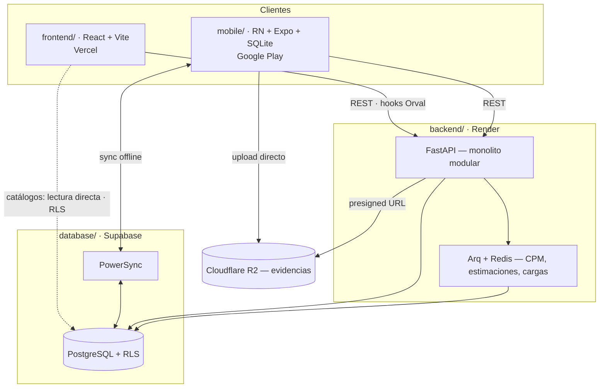

# ObraCtrl

Plataforma de **control de avance de obra** para construcción de vivienda en
serie (México, MXN). Gestiona la jerarquía **Proyecto → Cluster → Obra**, la
captura de avances en campo, la ruta crítica (CPM), incidencias, cierres,
estimaciones semanales, control de materiales, evaluaciones y el expediente
técnico por obra.

**Multi-tenant:** cada constructora opera aislada; toda entidad lleva `org_id`.

> **Fuente de verdad:** [`MD/ObraCtrl-especificacion-tecnica.md`](MD/ObraCtrl-especificacion-tecnica.md).
> Ninguna pieza inventa reglas: si falta una, se resuelve primero en el spec y
> cada entrega se traza a su sección (§).

## Las cuatro carpetas

| Carpeta | Qué es | Dónde vive | Stack |
|---|---|---|---|
| [`database/`](database/) | Esquema, RLS y semillas | **Supabase** | PostgreSQL 16 + RLS |
| [`backend/`](backend/) | API y lógica de dominio | **Render** | Python · FastAPI · SQLModel |
| [`frontend/`](frontend/) | Panel web (4 roles) | **Vercel** | React · Vite · Tailwind |
| [`mobile/`](mobile/) | App de campo (3 roles) | **Google Play** | React Native · Expo · PowerSync |



## Dos rutas de datos que no se mezclan (§10.7)

Es la decisión de arquitectura que más conviene entender antes de tocar código:

- **Catálogos** (selects, tablas, filtros) → el front consulta **directo a
  Supabase** con `supabase-js`. Rápido, con realtime opcional.
- **Lógica de dominio** (cargas/ETL, CPM, estimaciones, cierres, auditoría) →
  **siempre** por la API de FastAPI.

Como el front toca la BD directo, **RLS es la única frontera** de esa ruta. Se
usa la *anon key*; la **service key nunca llega al cliente**.

## Roles y alcance (§4)

Un usuario = un rol. El alcance lo impone la base, no la interfaz:

| Rol | Ve | Plataforma |
|---|---|---|
| **Residente de obra** | Sus obras | Web + móvil |
| **Supervisor de obra** | Sus clusters | Web + móvil |
| **Control de obra** | Sus proyectos | Web + móvil (solo revisión) |
| **Super intendente** | Toda la organización | Solo web |

En el cierre de actividad, **`validar` ≠ `autorizar`**: el Supervisor
**autoriza** (cierra la actividad), Control de obra **valida y comenta** (no
autoriza), y el Super intendente ejecuta el **cierre de obra final**.

## Estado

| | Listo | Falta |
|---|---|---|
| `database/` | 14 migraciones, RLS por rol, semillas, generador de calendario · **15 pruebas de aislamiento** | Sync rules en producción |
| `backend/` | Dominio puro: reglas de avance, motor CPM, flujo de cierre, folios, value objects · **79 pruebas** | Repositorios, módulos restantes del §11.2, cargadores Excel |
| `frontend/` | Shell de 3 columnas, navegación por rol, tokens, densidad, cliente Supabase y HTTP · **13 pruebas** | Las features de cada dominio |
| `mobile/` | Tabs por rol, esquema PowerSync, sync rules, config lista para Play | Pantallas reales, login, captura offline |

## Verificación

```bash
# Base de datos: migraciones + aislamiento RLS
cd database && DATABASE_URL="postgresql://..." ./scripts/migrar.sh && ./scripts/probar.sh

# Backend: dominio puro (no necesita BD)
cd backend && pip install -e ".[dev]" && pytest tests/domain -q
lint-imports              # la regla de dependencia se verifica en CI (§12.11)

# Frontend
cd frontend && npm install && npm run typecheck && npm test && npm run build

# Móvil
cd mobile && npm install && npm run typecheck
```

## Tres invariantes que conviene no romper

1. **La dependencia apunta hacia adentro** (§12.11). El `domain/` del backend
   no conoce FastAPI, SQLModel, RLS ni React. Lo verifica `import-linter` en
   CI, no la disciplina.

2. **Las reglas del §6 se definen una sola vez.** Viven en
   `backend/src/obractrl/domain/`; el front las **refleja** para UX; la BD las
   repite como `CHECK` porque es la última frontera de la ruta offline. Si una
   cambia, cambia en los tres lados a la vez.

3. **Las sync rules de PowerSync deben espejear RLS** (§12.4). Si el alcance
   de un rol cambia en `database/migrations/0011`, tiene que cambiar en
   `mobile/sync-rules.yaml`, o el offline expondría datos de otra
   organización.

## Documentación

| Archivo | Qué contiene |
|---|---|
| [`MD/ObraCtrl-especificacion-tecnica.md`](MD/ObraCtrl-especificacion-tecnica.md) | Especificación completa (§1–§12) |
| [`MD/DESIGN_SYSTEM.md`](MD/DESIGN_SYSTEM.md) | Sistema de diseño |
| [`MD/obractrl-design.css`](MD/obractrl-design.css) | Tokens y componentes — fuente de verdad visual |
| [`MD/AGENTS.md`](MD/AGENTS.md) | Contrato de coordinación de los agentes |
